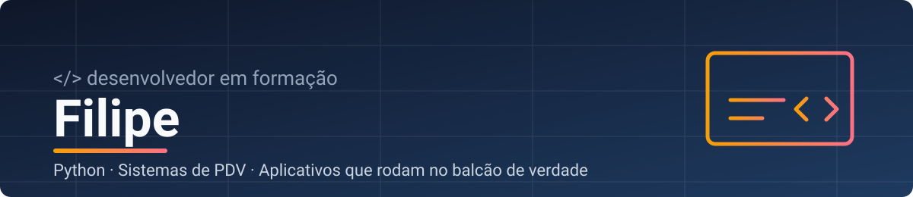

  

## Olá, eu sou o Filipe 👋

Estudo **Análise e Desenvolvimento de Sistemas** na UNINTER e sou formado em **Administração integrado ao Ensino Médio** pelo Instituto Federal de São Roque. Gosto de transformar problemas reais de pequenos negócios em programas simples de usar: caixa, comandas, estoque e relatórios.

Também curto jogos e música em estilos variados.

### O que eu construo

| Projeto | O que é | Tecnologias |
|---|---|---|
| [**A Tapioca**](https://github.com/Orthurus/a-tapioca) | Caixa (PDV) para tapiocaria: pedidos por mesa, cardápio, relatório de vendas, cupom e atualização automática | Python, Tkinter, PyInstaller, GitHub Actions |
| [**DoNata Lanches**](https://github.com/Orthurus/donata-lanches) | Sistema de comandas para lanchonete: app Android para o garçom e servidor no PC do caixa, com impressão por setor | Python, Kivy, Tkinter, HTTP, Buildozer |
| [**Mercadinho**](https://github.com/Orthurus/Mercadinho) | PDV e controle de estoque para mercado: código de barras, fiado, formas de pagamento, folha de caixa e backups | Python, Tkinter, SQLite |
| [**Meu portfólio**](https://github.com/Orthurus/meu-portfolio) | Site pessoal com apresentação, formação e contato | HTML, CSS, JavaScript |

### O que esses projetos têm em comum

- **Distribuição simples:** um único `.exe` (e `.apk` no caso do DoNata), sem instalação complicada.
- **Atualização automática** pelas Releases do GitHub, sem o cliente precisar baixar nada à mão.
- **Cuidado com os dados:** no A Tapioca, a gravação é atômica, há cópia de segurança e a atualização confere o SHA-256 e volta à versão anterior se algo falhar.
- **Documentação:** README com como usar, publicar e resolver problemas.

### Ferramentas

### Próximos passos

- A Tapioca: migrar os dados de arquivos JSON para **SQLite** e registrar pagamentos (forma, valor recebido e troco)
- Mais testes automatizados e código organizado em módulos

---

Inglês intermediário (CNA, curso incompleto).
